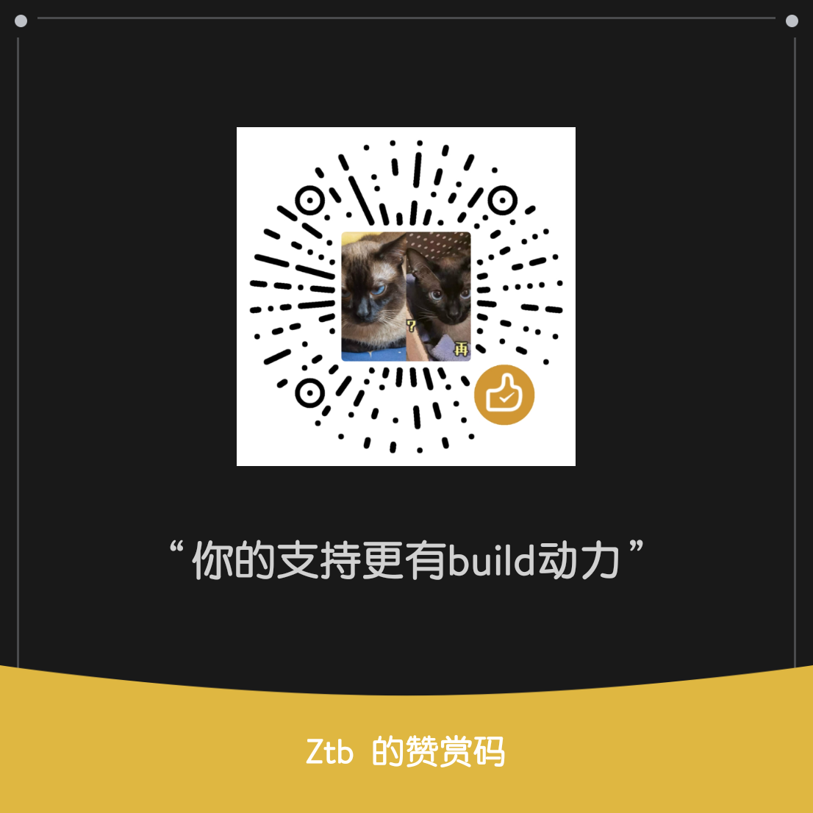

# ZtbWrt CI — Airoha AN758x PON 云编译
> 固件免费开源分享。如果帮你省了事、省了心，欢迎扫码支持一下 ☕ —— 您的每一份心意，都是本ID继续编译、持续更新的动力
>
> 

---
基于 P3TERX `Actions-OpenWrt` 模板重构，源码指向 [pbs05/ponwrt](https://github.com/pbs05/ponwrt)（默认分支 `master`），
## 支持的机型

| SoC | profile |
|-----|---------|
| AN7581 | `fiberhome_hg5382a` `fiberhome_hg5585f-ct` `fiberhome_hg5585f-cu` `gemtek_xg2010g` `nokia_xg-040g-md-ubi` `nokia_xg-040g-tf-ubi` `unionman_ung00a` `znxt_zn504xg-d` `znxt_zn515xg-d` |
| AN7583 | `nokia_xg-040g-mf` `nokia_xg-040g-mf-ubi` |

## Release 4 个变体(强烈推荐 openclash和honk，openclash最简单好用，honk需要折腾一下)

- openclash版 https://github.com/vernesong/OpenClash
- dae版 https://github.com/daeuniverse/dae
- honk版 采用404大佬的库 感谢大佬 https://github.com/QiuSimons/luci-app-honk
- 啥都不带版

注意，本hub编译的404大佬的honk自带v2ray的geoip/site库（/user/share/v2ray/），在honk启动时候加入变量引入使用。

### AN7583 带硬解AES功能，AN7581带软解

## ☕ 赞赏支持

固件为**免费开源**分享。如果您觉得好用，欢迎扫码支持一杯咖啡，让ZTB有动力持续维护、继续编译更新。

