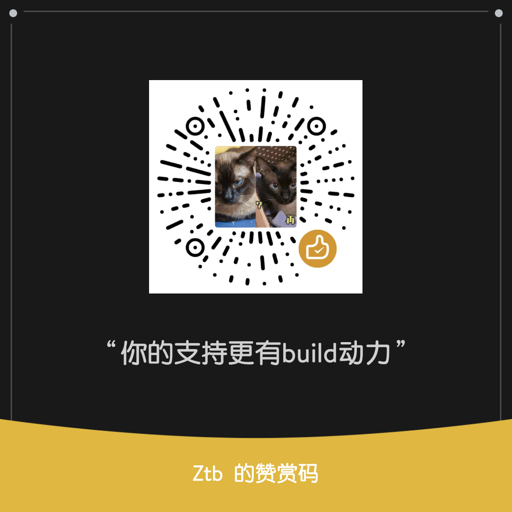

# ZtbWrt CI — Airoha AN758x PON 云编译

基于 P3TERX `Actions-OpenWrt` 模板重构，源码指向 [pbs05/ponwrt](https://github.com/pbs05/ponwrt)（默认分支 `master`），
> 固件免费开源分享。如果帮你省了事、省了心，欢迎扫码支持一下 ☕ —— 您的每一份心意，都是本ID继续编译、持续更新的动力
>
> 

---

### diy-part1.sh —— 拉插件

## 支持的机型

| SoC | profile |
|-----|---------|
| AN7581 | `fiberhome_hg5382a` `fiberhome_hg5585f-ct` `fiberhome_hg5585f-cu` `gemtek_xg2010g` `nokia_xg-040g-md-ubi` `nokia_xg-040g-tf-ubi` `unionman_ung00a` `znxt_zn504xg-d` `znxt_zn515xg-d` |
| AN7583 | `nokia_xg-040g-mf` `nokia_xg-040g-mf-ubi` |

机型名写错会在 `Generate toolchain cache key` 步骤直接报 `::error::` 并退出，不会静默地全机型编译。

### diy-part2.sh —— 自定义一些参数软件包

## Release 3 个变体

- openclash版
- dae版
- honk版
- 啥都不带版

### AN7583 带硬解AES功能，AN7581带软解

